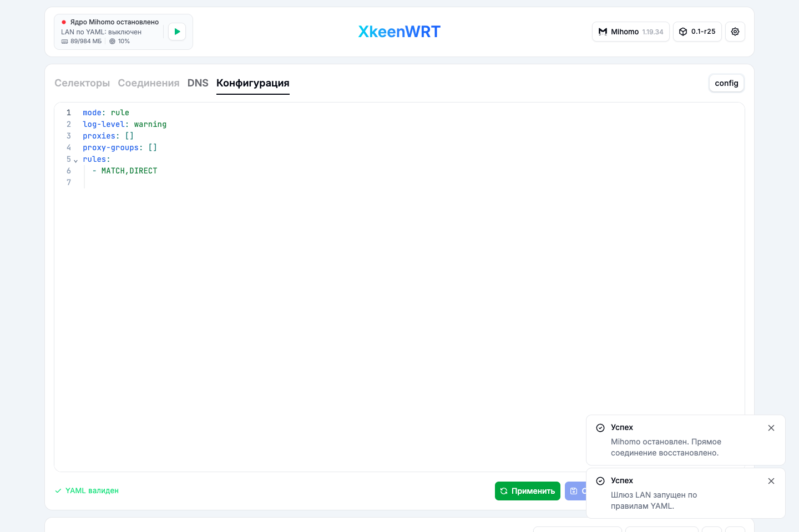

<div align="center">
  
  <h1>XkeenWRT</h1>
  <p>Независимый порт веб-панели <a href="https://github.com/zxc-rv/XKeen-UI"><strong>XKeen-UI</strong></a> от zxc-rv для <strong>OpenWrt</strong> с движком <strong>Mihomo</strong>.</p>
  <p>
    <a href="#быстрый-старт">⚡ Установка</a> ·
    <a href="#возможности">🎛️ Возможности</a> ·
    <a href="#совместимость">🧩 Совместимость</a> ·
    <a href="https://github.com/First026/XkeenWRT-Mihomo/releases/tag/v0.1.26.4">📦 Релиз 0.1.26.4</a>
  </p>
</div>

## Быстрый старт

Выполните команду в **SSH-терминале роутера** под `root`. Для загрузки нужен `curl`.

```sh
curl https://raw.githubusercontent.com/First026/XkeenWRT-Mihomo/main/install.sh | sh
```

Установщик проверит OpenWrt и SHA‑256 обоих APK, добавит недостающие зависимости и покажет адрес панели. Та же команда обновляет установленную 0.1.26.3 на месте с сохранением профилей и Mihomo; перед обновлением нажмите в панели **Остановить**.

1. Откройте `http://<IP-роутера>:1000/` из локальной сети. Нажмите **Mihomo** и установите движок через каталог.
2. Добавьте подписку или YAML и нажмите **Применить**.
3. Нажмите верхнюю кнопку **Запустить**. Статус **LAN по YAML** покажет, включён ли перехват.

Вне дома панель открывается через Tailscale по адресу роутера в tailnet: `http://<Tailscale-IP>:1000/`. Оттуда тоже работают **Запустить**, перезапуск шлюза, **Применить** и **Остановить**. Так как вы не в LAN, перед подтверждением роутер сам проверяет шлюзовый DNS и выход в интернет хотя бы через один прокси; если проверка не прошла, перехват сразу снимается. HTTP/SOCKS включается только из LAN.

## Возможности

- ▶️ Запуск и остановка Mihomo и IPv4-шлюза LAN одной верхней кнопкой — из LAN или через Tailscale.
- 📝 Редактор YAML с проверкой, импорт подписок и просмотр провайдеров и наборов правил.
- 📊 Селекторы, соединения, DNS и журнал с фильтром.
- 🔧 Установка и обновление Mihomo из панели.
- 🔍 Проверка совместимости в **Диагностике**. Отдельный HTTP/SOCKS доступен в **Расширенных настройках**.

<p align="center">
  
</p>

## Совместимость

| Параметр | Поддерживаемая сборка |
| --- | --- |
| Прошивка | OpenWrt 25.12.6 |
| Target | `mediatek/filogic` |
| Архитектура APK | `aarch64_cortex-a53` |
| LAN-перехват | Основная IPv4-подсеть. Внешний IPv6 в области перехвата блокируется |

Зависимости устанавливаются из настроенных репозиториев OpenWrt. Для kmod нужен feed с ABI ядра устройства. Активный аппаратный flow offload блокирует запуск шлюза, причина отображается в диагностике.

На OpenWrt ARM64 VM проверены установщик 0.1.26.4 (обновление с 0.1.26.3 на месте), вся LAN по правилам профиля, запуск через Tailscale с проверкой DNS и выхода на самом роутере, отказ и снятие перехвата при недоступном прокси или DNS, «Применить» и перезапуск на работающем шлюзе из LAN и через Tailscale, остановка после разового сбоя recovery, обновление из панели на следующую версию ([отчёт](docs/testing/2026-11-18-0.1.26.4-lab-acceptance.md)). Проверка на физическом роутере в этот прогон не входила.

## APK, обновление и удаление

[Скачать APK и сверить SHA‑256](https://github.com/First026/XkeenWRT-Mihomo/releases/tag/v0.1.26.4)

<details>
<summary>Ручная установка двух APK</summary>

Возьмите `core` и `ui` из одного релиза, сверьте SHA‑256 и скопируйте оба файла на роутер. APK проекта не подписаны. Выполните команду из каталога с файлами после установки зависимостей.

```sh
apk --no-network --allow-untrusted --force-non-repository \
  --repositories-file /dev/null add \
  ./xkeenwrt-core-0.1.26.4-r0.apk ./xkeenwrt-ui-0.1.26.4-r0.apk
```
</details>

Быстрый установщик ставит 0.1.26.4 начисто или обновляет полную установку 0.1.26.3 на месте; при запущенном сервисе он откажет и попросит нажать **Остановить**. Перед чистой переустановкой проверьте, что нужный YAML сохранён.

**Обновление из панели** — начиная с 0.1.26.4. Нажмите **Остановить**, затем кнопку с версией вверху панели: там будут релизы новее установленного. Выберите версию и нажмите **Установить**. Роутер скачает с GitHub установщик этого релиза — тот же, что в быстром старте, — и обновит оба APK с проверкой SHA‑256. Панель перезапустится и покажет результат. Затем нажмите **Запустить**. Когда выходит новая версия, кнопка подсвечивается. Откат на старую версию — только по SSH ([решение 026](docs/decisions/026-panel-self-update.md)).

Версия записана как `0.1.26.4`, а не `0.1-r26.4`: apk-tools 3 допускает после `-r` только целое число. Следующие выпуски — `0.1.27`, `0.1.27.1` и далее.

Пакеты 0.1-r26 и более ранних выпусков больше не публикуются, поэтому откат на них не поддерживается. Откат на 0.1.26.2 после запуска через Tailscale — только [по инструкции](docs/clean-reinstall.md#откат-01263--01262). Удалить XkeenWRT:

```sh
apk --no-network --repositories-file /dev/null del xkeenwrt-ui xkeenwrt-core
```

[Состояние и профили при чистой переустановке](docs/clean-reinstall.md)

## Исходники и лицензии

За основу взят [XKeen-UI v1.4.6](https://github.com/zxc-rv/XKeen-UI/tree/b8ed60c098594c356c0ae871f77fc6598e0a9c8c) автора zxc-rv. Оригинальный [текст лицензии MIT](LICENSE) и уведомление `Copyright (c) 2026 zxc-rv` сохранены в исходниках и в обоих APK.

Панель загружает движок из [релизов Mihomo](https://github.com/MetaCubeX/mihomo/releases). Лицензия движка — [GPL-3.0](https://github.com/MetaCubeX/mihomo/blob/v1.19.34/LICENSE).

[Происхождение компонентов](docs/UPSTREAM.md) · [Сборка ARM64](docs/arm64-build.md)
